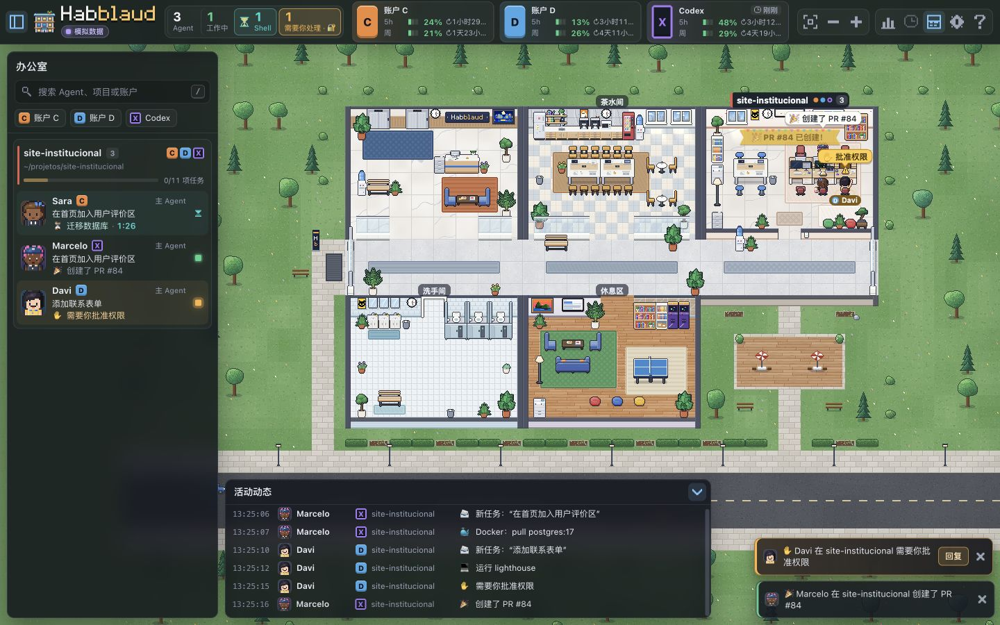
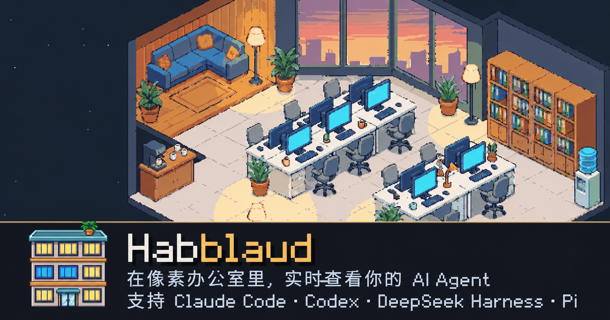

<p align="center"></p>

<h1 align="center">Habblaud</h1>

<p align="center"><b>Bring local Claude Code, Codex, DeepSeek Harness, and Pi agents into one pixel-art office.</b><br />One room per project, one character per session, with a live view of who is working, waiting for you, or finished.</p>

<p align="center">
  
  
  
</p>

**Documentation:** [简体中文](README.md) · [English](README.en.md) · [Português (Brasil)](README.pt-BR.md) (upstream reference, v0.8.0)

**Links:** [Fork repository](https://github.com/501981732/habblaud) · [Upstream project](https://github.com/marmottajr/habblaud) · [Integration guide (Chinese)](docs/zh-CN/接入与故障排查.md) · [Validation record (Chinese)](docs/zh-CN/验证记录.md) · [MIT License](LICENSE)




These screenshots show the Chinese-language UI with demo data. The [Chinese settings](docs/screenshots/zh-CN/settings.jpg), [help page](docs/screenshots/zh-CN/help.jpg), and [mobile layout](docs/screenshots/zh-CN/mobile-settings.jpg) screenshots are also available. See the [Chinese validation record](docs/zh-CN/验证记录.md) for the scope and results of local integration.

The UI supports **Simplified Chinese (`zh-CN`) and Brazilian Portuguese (`pt-BR`)**. The first launch defaults to Simplified Chinese; select Português (Brasil) under Settings → Language (设置 → 语言) to switch. The choice is saved in the browser. Project and model names, your original messages to agents, commands, and tool results retain their original text. The Portuguese README is the upstream reference: [README.pt-BR.md](README.pt-BR.md).

## Features and data sources

| Feature | Claude Code | Codex | DeepSeek Harness (DSH) | Pi |
| --- | --- | --- | --- | --- |
| Project rooms, online status, activity, conversations | Local sessions; plugin adds live signals | Local sessions; hooks add live signals | Native Cordis plugin | Native extension |
| Recent sessions and conversation history | Local transcripts | Local session files | Native DSH session query, cached through the bridge | Current branch of Pi session JSONL |
| Send a message from the web UI | Messaging plugin | Local `codex queue` | Native `sessionController.prompt()` | Native `pi.sendUserMessage()` |
| Handle approvals from the web UI | Permission plugin | Hooks | Native approval callback; falls back to DSH Web UI if disconnected | Optional tool approval; off by default |
| Usage | 5-hour/weekly limits and tokens | Limits and tokens provided by Codex | Tokens reported by DSH; unknown prices/limits are not estimated | Tokens/cost reported by Pi; unknown values are not estimated |

“Runtime” means Claude Code, Codex, DSH, or Pi; GLM, DeepSeek, and similar names refer to **models** selected within a runtime. For example, when DSH uses GLM, the office identifies DSH as the source and GLM as the model; it does not present the session as Claude Code or Codex. Buttons appear only when the session supports the corresponding capability. Cached history remains available when a plugin is offline, and disconnected sessions are not shown as online agents.



The share graphic is in Chinese.

## Install and start

You need Node.js **22.19 or later**, npm, and at least one local agent runtime. The Pi SDK requires Node.js ≥22.19.0. macOS and Linux can run directly with Node. The upstream Windows and Docker paths remain available for Claude Code/Codex. For the new native bridges, start with Node mode on the same machine.

```bash
git clone https://github.com/501981732/habblaud.git
cd habblaud
npm ci
npm run build
npm start
```

Open <http://127.0.0.1:4747>. By default, the server listens only on the local loopback interface. For development, run `npm run dev` to start the server with hot reload. If the port is occupied, use `HABBLAUD_PORT=4848 npm start`; after changing the port, configure Codex hooks and plugins to use the same port.

To explore the UI first, run `npm run demo`, or enable demo mode in Settings after starting the server. Demo agents, conversations, and accounts are fictional and can appear alongside real sessions.

### Claude Code

If you have local Claude Code sessions, Habblaud can read their local records and show rooms, activity, history, and terminals. Installing the plugins is recommended for usage, live waiting signals, web messaging, and approvals:

```bash
npm run mod:install
npm run mod:status
```

`mod:install` uses Claude Code's official plugin commands to install the observer mod, permission plugin, and messaging plugin for detected accounts. It backs up configuration before changing it. Use `-- --sem-permissoes` or `-- --sem-mensagens` to omit the corresponding plugin. Older Claude Code versions can use `npm run usage:install` and `npm run hooks:install` separately. See the [Claude plugin guide (Chinese)](mod/README.md).

For already-open Claude Code sessions, run `/reload-plugins` or reopen the session to load the plugins. The `/habblaud` plugin command shows an office summary in the terminal. Account directories are discovered from `CLAUDE_CONFIG_DIR` and `~/.claude*` by default; you can also set `HABBLAUD_CLAUDE_DIRS`.

### Codex

Codex CLI/Desktop sessions are located in `~/.codex`, `CODEX_HOME`, or automatically discovered `~/.codex*` directories. Existing sessions can be read without hooks. To see more timely steps and handle approvals in the web UI:

```bash
npm run codex:install
npm run codex:status
```

Approve the new hooks in Codex `/hooks`, then reopen affected sessions. The installer adds only Habblaud's hooks, backs up the existing configuration, and preserves other hooks. Web messages are delivered through the local `codex queue` command. If the command is not on `PATH`, set `HABBLAUD_CODEX_BIN=/absolute/path/codex`. Set `HABBLAUD_CODEX_DIRS` (comma-separated) for custom account directories; set `HABBLAUD_CODEX=0` to disable this source.

### DeepSeek Harness (DSH), including GLM in DSH

DSH requires a native plugin. It reads state and decoded history from the DSH process, delivers messages through the native session controller, and handles live approvals when a local Habblaud page is open. DSH's own Web UI remains available; if the bridge disconnects or no Habblaud page is open, approvals return to the DSH Web UI.

Start the Habblaud Node service described above, then install the plugin from the repository directory. The following uses the common `web` profile:

```bash
npm run dsh:install -- --profile web
npm run dsh:status -- --profile web
```

The installer adds the locally built plugin to the profile using DSH's official `dsh plugin` command and backs up manifest files it may change. Reinstalling the same source does not overwrite other plugins. If `dsh` is not on `PATH`, add `--dsh /absolute/path/dsh`; use `--dsh-home /directory` for another DSH_HOME. Existing processes may hot-reload; check `dsh:status` and the sessions shown in the office. DSH continues to manage its own model, authentication, and working directory.

Habblaud generates a private local bridge configuration for the plugin, at `~/.habblaud/bridge.json` by default. **Do not commit this file or paste its contents into an issue.** If you use a separate data directory or multiple Habblaud instances, set the same `HABBLAUD_BRIDGE_CONFIG=/absolute/path/bridge.json` for the server and DSH process. Remove the plugin with `npm run dsh:uninstall -- --profile web`. See the [DSH guide (Chinese)](integrations/dsh/README.md).

The DSH plugin has been observed loading and reporting sessions on a locally running DSH + GLM setup. The tested scope for model calls, messaging, and approvals is defined by this PR's acceptance record.

### Pi

Pi connects through a native extension. After building, explicitly load the extension in the Pi process you want to observe. The Habblaud service must be running on the same machine:

```bash
pi --extension /absolute/path/habblaud/integrations/pi/dist/index.js
```

The extension follows session, tool, and message events from the current Pi process. For history, it scans Pi session JSONL read-only and reconstructs the conversation along the current branch. The default directory is `sessions/` under `PI_CODING_AGENT_DIR` or `~/.pi/agent`. To use multiple data directories, set `HABBLAUD_PI_DIRS` to a list of **Pi agent directories**: use `:` on macOS/Linux and `;` on Windows. The code looks for `sessions/` under each directory.

Pi tool approval is **off by default**. To handle every Pi tool call from the web UI, set `HABBLAUD_PI_APPROVALS=1` before starting Pi. If the local bridge is unavailable, approval falls back to Pi's own confirmation UI. A missing interactive UI, cancellation, or timeout never grants approval automatically. The web UI offers one-time allow/deny only; it does not provide Claude Code's “always allow” or question suggestions. See the [Pi extension guide (Chinese)](integrations/pi/README.md).

The Pi extension has been tested for local loading and events against the official SDK. Whether a real Pi model call was completed is determined by this PR's acceptance record; loading the extension does not prove the model path works.

### Docker and LAN access

The existing Docker path for Claude Code/Codex remains available with `npm run docker:up`, `npm run docker:logs`, and `npm run docker:down`; the container mounts the required session directories read-only. For Codex web messaging in container mode, also run `npm run codex:bridge` on the host. The recommended path for DSH/Pi native bridges is the Node mode above; this branch has not validated the new native bridges as a Docker setup.

If you expose the page to your LAN with `HABBLAUD_HOST=0.0.0.0` or Docker's `HABBLAUD_BIND=0.0.0.0`, terminals, conversation history, web messaging, approvals, character editing, and native bridges are disabled. Read-only office status remains available; sensitive content and actions are enabled only for local loopback access.

### Update from an older version

Update an existing repository using your usual Git workflow, then run `npm ci`, `npm run build`, and restart the server. Rerun `mod:install` if the Claude plugin directory changed; check Codex hooks with `codex:status`; reinstall the DSH plugin if you move the repository because it uses a local build path. Update the `--extension` path in the Pi command as well.

Installations from older CodeTown versions now use `HABBLAUD_*` environment variables; `CODETOWN_*` variables no longer work. For upstream data migration and replacing old plugins, see the [migration section in the Portuguese upstream README](README.pt-BR.md#vindo-do-codetown). Back up any screenshots, exports, or other files you saved in the old data directory before updating.

## Using the interface

- **Office and sidebar:** Each active project gets a room, and each session gets a character. Characters work, idle, wait for your permission or answer, and leave when the task ends. Subagents are labeled. Rooms can be renamed; characters' appearance and names can be edited in their details. Lighting and day/night change with their state.
- **Activity and details:** Click a character to see current work, tool activity, tasks, and recent timeline. Reorder items in the sidebar by dragging. Labels such as `DSH` and `Pi` identify the runtime; the model name is shown separately.
- **Terminal and history:** When accessed locally, click an agent to open its conversation, including user messages, replies, tool calls, and results. The history page shows recently closed sessions. Long conversations are truncated by item count and byte size. Session text is shown as-is; only UI-generated descriptions change with the UI language.
- **Web messages:** Type in the agent details or terminal. The UI distinguishes queued, delivered, and failed messages. “Delivered” means the runtime accepted the message; **it does not mean the model completed the task**. A button appears only when the relevant agent and bridge are online and messaging is available.
- **Permissions and questions:** When an agent requests permission, its character raises a hand and the sidebar and notifications alert you. You can allow or deny in the web UI, or handle the request in the original terminal. Only decisions supported by the source are shown. If no local page is available or the bridge is disconnected, the runtime's native flow handles it.
- **Usage and statistics:** Account usage appears at the top when data is available. “My Day” summarizes work time, tools, tokens, and available costs by project, account, and agent. DSH/Pi usage is not represented as Claude subscription limits.
- **Timeline playback:** The office state can be recorded and replayed by day. By default, only summaries from the last seven days are kept. Set `HABBLAUD_TIMELINE=0` to stop new recording.
- **GitHub animations:** When actual push, PR, CI, or release results are identified from local sessions, rooms can celebrate or show an alert. Failed commands do not count as success.
- **Life scenes:** Idle characters interact in places such as the lounge and kitchen. Personalities and small actions are generated consistently for each character.
- **Mobile layout:** The sidebar and details become drawers; draggable desktop panels return to a fixed layout on narrow screens.

Chinese screenshots are in [docs/screenshots/zh-CN](docs/screenshots/zh-CN/). Portuguese upstream images and descriptions remain in [README.pt-BR.md](README.pt-BR.md). The Chinese share graphic, pixel-art asset pipeline, and update notes are in [Assets and Chinese images (Chinese)](docs/zh-CN/素材与中文图片.md).

### Rooms, characters, and states

When an agent enters a project, it takes the elevator to that project's room. Claude Code and Codex sessions in the same project can share a room while keeping their source labels. The main agent and subagents are shown separately when there is reliable parent/child evidence. When the project's last session ends, the characters leave, the lights go out, and the empty room eventually becomes a garden. A new session sets up the room again.

States such as `working`, `idle`, `waiting`, and `shell` indicate active execution, temporary inactivity, a need for your answer, or a background command running. The wait time and completion/failure effects for `shell` come from actual command signals; they are not inferred from an old conversation. DSH/Pi states come from native events. After a disconnection, a session does not remain “working” indefinitely.

Drag rooms and main agents in the sidebar to reorder them; right-click a room to rename it. Click the pencil in the main agent's details to change the project character's name, skin, hair, clothes, and other appearance settings, or choose “Return to random appearance.” Room names and characters are stored in the Habblaud data directory and are not written to agent project repositories. Character editing requires local sensitive features to be enabled.

### Activity, terminal, and messages

The activity feed summarizes tools, files, commands, searches, and session states. The details panel lists tasks, subagents, tool counts, and recent activity; long timelines can be expanded in batches. The terminal shows messages and tool results from the current session, reading real records or normalized records supplied by the native bridge. On reconnect, it sends `init` again to avoid appending content from a different turn or session to the old one.

Send a message at the bottom of the details or terminal panel; the web UI first shows its delivery state. The Claude Code messaging plugin submits a user message in its interactive session; Codex calls the local `codex queue`; DSH/Pi use their respective native delivery APIs. A queued message may wait until the current task finishes. Before sending, confirm the agent's working directory and model, especially when multiple projects have the same name.

User prompts, commands, and tool results in the terminal retain their original language. Switching the UI language changes product labels such as “Send,” “Delivered,” and “Tool completed”; it does not rewrite the conversation or translate the task you entered. Paths, usernames, and model names shown on screen likewise retain their source values.

### Approvals and waiting

When a runtime emits an explicit live approval request and a local Habblaud page is open, the sidebar and character indicate that your attention is needed. Open the request to inspect the tool/input and choose from the decisions supported by that source. Claude Code's AskUserQuestion can be answered using information exposed by its native hook; Codex, DSH, and Pi are not given options from another runtime.

If you handle a request first in the original terminal or DSH Web UI, its pending card should disappear from the web UI. If the page closes, the bridge disconnects, or the request is canceled or expires, the plugin must return to the native flow or deny it; there is no generic auto-approval. To keep every approval in Pi's own UI, leave `HABBLAUD_PI_APPROVALS` unset.

### Accounts, usage, and “My Day”

Habblaud distinguishes source accounts using each runtime's account directories. The Claude Code mod writes 5-hour/weekly windows and reset times; Codex shows only the limit information it provides. DSH/Pi tokens or costs are displayed when reported. If they do not provide subscription limits, the UI should show unknown or omit the limit card rather than reuse Claude limits.

“My Day” aggregates work, waiting, tool calls, tokens, and available costs by local date, with views by project/account/agent. These statistics represent sessions observed by Habblaud; they are not exact model-platform invoices. Values may be incomplete if a plugin is offline, an older session was not discovered, or a source does not provide costs. Changing the UI language changes date and number formatting, not the underlying values.

### Timeline playback and social animations

Timeline playback shows how the office changed throughout a day. It records rooms, states, short activity descriptions, and usage summaries. The last seven days are retained by default. Disable `HABBLAUD_TIMELINE` to stop new recordings. Run `npm run demo:timeline` to generate fictional playback data for trying the UI or recording a demo.

Idle characters meet, talk, or play games in the lounge, kitchen, and recreation area; their personalities, small actions, and coins are office performances. Celebrations/alerts for GitHub push, PR, CI, and release results come from tool results in sessions, with time windows and deduplication. Replaying history does not notify old results as if they had just happened.

### Page layout and notifications

Account usage and global controls are at the top, rooms and agents are in the sidebar, and the activity feed is at the bottom. Click a character to open details. On desktop, the terminal and details can be dragged and resized; at mobile widths, they return to touch-friendly drawers. Settings include language, sound, and browser notification preferences. Browser notifications require your permission in the browser.

Bubbles, room labels, and GitHub banners on the canvas also use the Chinese/Portuguese translation layer and a font fallback that can display Chinese characters. The Chinese screenshots should come from the actual rendered UI, with visible product text in Chinese; the brand name `Habblaud` may remain unchanged.

## Architecture and API overview

`server/sources` handles Claude Code/Codex file sources. `integrations/dsh` and `integrations/pi` run inside their respective agent environments. `server/bridge` validates native events and maintains source status and a private history cache. `server/model` combines them into rooms and agents, and `client` renders the pixel office through SSE.

| HTTP endpoint | Purpose |
| --- | --- |
| `GET /api/health`, `GET /api/snapshot` | Health and current office state |
| `GET /api/stream` | Server-pushed snapshots, activity, and notifications |
| `GET /api/agents/:id/terminal` | Current agent conversation stream |
| `GET /api/sessions/recent` | Recent historical sessions |
| `GET /api/stats`, `GET /api/timeline/days` | Daily aggregates and timeline playback |
| `POST /api/messages`, `POST /api/permissions/:id/decision` | Send a local message and handle a pending approval |

`/api/bridge/*` is for DSH/Pi plugins only, accessed locally with a private token; it is not a public browser API. See the [server guide (Chinese)](server/README.md) and [bridge protocol](shared/native-bridge.ts) for fields and limits.

In a local deployment, the frontend, HTTP API, and SSE share one port. DSH/Pi plugins send events and poll for commands through the local bridge on that port. Browser windows share the same office snapshot, while UI-only preferences such as language and panel position are stored by each browser. Other sources should continue updating if one provider disconnects.

## Common configuration

| Variable | Default | Purpose |
| --- | --- | --- |
| `HABBLAUD_PORT` | `4747` | HTTP port |
| `HABBLAUD_HOST` | `127.0.0.1` | Node listen address; sensitive features are disabled on non-loopback addresses |
| `HABBLAUD_DATA_DIR` | `~/.habblaud` | Room/character data, statistics, playback, and native bridge cache |
| `HABBLAUD_BRIDGE_CONFIG` | `<HABBLAUD_DATA_DIR>/bridge.json` | Local DSH/Pi bridge configuration; if not explicitly set for the plugin, it reads `~/.habblaud/bridge.json` |
| `HABBLAUD_CLAUDE_DIRS` | Auto-discovered | Claude Code account directories, comma-separated |
| `HABBLAUD_CODEX_DIRS` | Auto-discovered | Codex account directories, comma-separated |
| `HABBLAUD_CODEX_BIN` | `codex` on `PATH` | Codex message queue command |
| `HABBLAUD_DSH` / `HABBLAUD_PI` | Enabled | Set either to `0` to disable that source |
| `HABBLAUD_PI_DIRS` | Default Pi agent directory | Multiple Pi agent directories, separated by the system's `path.delimiter` |
| `HABBLAUD_PI_APPROVALS` | Off | Set to `1` in the Pi process to take over tool approvals |
| `HABBLAUD_TERMINAL` | On for local access | Set to `0` to disable sensitive features such as conversations, approvals, and messages |
| `HABBLAUD_MENSAGENS` | Follows terminal setting | Set to `0` to disable only web messaging |
| `HABBLAUD_TIMELINE` | On | Set to `0` to stop timeline recording |
| `HABBLAUD_UPDATE_CHECK` | On | Set to `0` to disable GitHub release checks |
| `HABBLAUD_DEMO` | Off | Set to `1` to start with demo characters |

The default path for `HABBLAUD_BRIDGE_CONFIG` depends on the data directory. If the server uses a temporary `HABBLAUD_DATA_DIR` while a running DSH/Pi process still reads `~/.habblaud/bridge.json`, they will not connect. Before starting the plugin process, configure both sides to read the same path. Do not put the bridge token in a command line, log, screenshot, or repository.

## Operation and security boundaries

The server normalizes local Claude Code/Codex records and events from the DSH/Pi native bridge into one Office model. The browser updates the office over SSE at `/api/stream`, gets the current state from `/api/snapshot`, and receives terminal conversations through a separate stream. Claude Code and Codex continue to use their existing readers and installers. DSH uses the official session query to decode compressed history; Pi history reads only the current branch of the session tree. Older records without a provider are still treated as Claude Code.

The native bridge is available only on loopback and requires a random token from private local configuration. The server also checks Host, Origin, and local binding. Events and commands have size limits; duplicate sequence numbers do not create activity again. Native messages and approvals obey the existing local-access restrictions for the terminal. After a bridge disconnects, the session goes offline while already retrieved history remains viewable; late approvals are not automatically granted.

By default, the server does not send sessions to external services. When update checks are enabled, it periodically queries the public GitHub API for releases; see the table above to disable them. Conversations may contain sensitive information: open the terminal only locally, and avoid uploading screenshots of real conversations to public issues/PRs. Timeline playback stores office summaries, not full conversations; native history caches are in the private local data directory.

For more on HTTP endpoints, cache limits, and boundaries, see the [server guide (Chinese)](server/README.md). For native plugin runtime constraints, see the [DSH guide (Chinese)](integrations/dsh/README.md) and [Pi guide (Chinese)](integrations/pi/README.md).

## Update, uninstall, and troubleshooting

After updating the code, run `npm ci && npm run build` and restart Habblaud. If the Claude Code plugin path or version changed, rerun `npm run mod:install`; for Codex, run `npm run codex:status`; for DSH, run `npm run dsh:status -- --profile web` and reinstall if the build location changed. The Pi startup command should point to the current `integrations/pi/dist/index.js`.

```bash
npm run mod:uninstall
npm run codex:uninstall
npm run dsh:uninstall -- --profile web
```

These commands remove only plugins or hooks added by Habblaud. Disable the Pi extension by removing the `--extension` argument when starting Pi. `npm run docker:down` only stops the container.

**Agents are not visible:** Confirm that the real session has produced a message and that the target process loaded its plugin/extension. For Claude Code/Codex, check the account directories; for DSH, check the profile and `dsh:status`; for Pi, confirm `--extension` points to the built file. `GET /api/health` shows service status and enabled sources.

**Messaging/approvals are unavailable:** Check that the page is accessed through `127.0.0.1` or `localhost`, the server listens on loopback, and `HABBLAUD_TERMINAL` and `HABBLAUD_MENSAGENS` are enabled. Codex needs a runnable `codex` command; Claude Code needs its plugin; DSH/Pi need a running bridge. Pi approvals also require `HABBLAUD_PI_APPROVALS=1`.

**DSH or Pi history is empty:** DSH must read decoded history from the native session query; compressed files cannot be treated directly as JSONL. For Pi, confirm `PI_CODING_AGENT_DIR` / `HABBLAUD_PI_DIRS` points to agent directories and that the files are readable, real sessions from the last seven days. A disconnected native process does not keep an old session marked online.

**Port conflict or LAN access:** Change `HABBLAUD_PORT` and reconfigure the plugins. LAN pages retain read-only office status; allowed Host names do not re-enable sensitive operations.

For source-by-source checks and local bridge configuration, see [Connecting and troubleshooting the four agent runtimes (Chinese)](docs/zh-CN/接入与故障排查.md).

## Development and project origin

```bash
npm run typecheck
npm test
npm run build
```

This fork retains the upstream [marmottajr/habblaud](https://github.com/marmottajr/habblaud) origin and MIT license. Changes in this fork are listed in [CHANGELOG.md](CHANGELOG.md); architecture and acceptance scope are described in the [design spec (Chinese)](docs/superpowers/specs/2026-10-13-zh-native-agents-design.md). The actual results of local integration, browser screenshots, and CI are recorded in the corresponding PR validation record.
