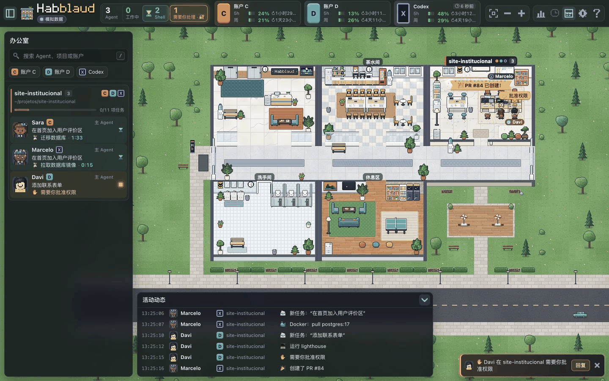

<p align="center">
  
</p>

<h1 align="center">Habblaud</h1>

<p align="center">
  <a href="README.md">English</a> ·
  <b>简体中文</b> ·
  <a href="README.pt-BR.md">Português (Brasil)</a>
</p>

<p align="center">
  <b>给编程 Agent 一间像素办公室。</b><br />
  一个项目一间房，一个会话一名角色。<br />
  实时查看 Claude Code、Codex、DeepSeek Harness 和 Pi 的工作、等待与完成状态。
</p>

<p align="center">
  
  
  
  
</p>

<p align="center">
  <a href="#安装与启动">快速开始</a> ·
  <a href="#接入-agent">Agent 接入</a> ·
  <a href="docs/zh-CN/接入与故障排查.md">接入指南</a> ·
  <a href="https://github.com/501981732/habblaud">项目仓库</a> ·
  <a href="LICENSE">许可证</a>
</p>

<p align="center">
  
</p>

---

同时在几个项目里运行 Agent，很容易忘记谁在做什么。**Habblaud** 把这些会话变成一座一眼就能看懂的办公室：谁正在敲键盘，谁举手等待许可，谁留下命令还在运行，谁已经完成。点击角色，就能查看对话、发送下一条指令，或处理当前审批。

任务之间，办公室也有自己的生活。角色会喝咖啡、看电视、玩游戏、和同事聊天。这些动画只发生在 Habblaud 中，Agent 继续正常工作。

办公室在本机运行。Claude Code 和 Codex 使用本地会话记录，DSH 和 Pi 通过原生插件接入。界面支持**简体中文和巴西葡语**，首次打开默认中文，可在「设置 → 语言」切换。提示词、命令、路径、模型名和工具结果保留原文。

## 目录

- [界面与功能](#界面与功能)
- [支持的 Agent](#支持的-agent)
- [安装与启动](#安装与启动)
- [接入 Agent](#接入-agent)
- [使用办公室](#使用办公室)
- [常用配置](#常用配置)
- [隐私与安全](#隐私与安全)
- [更新与移除](#更新与移除)
- [故障排查](#故障排查)
- [开发](#开发)
- [作者与许可证](#作者与许可证)

## 界面与功能

- **房间与角色**：每个活动项目一间房。主 Agent 和受支持的子 Agent 从电梯进入、在桌前工作，并在会话结束后离开。
- **实时活动**：查看工具、文件、搜索、命令、任务和最近活动；运行环境与模型名称分别显示。
- **对话与历史**：在本机网页查看当前会话和最近关闭的会话，包括工具调用及结果。
- **消息与审批**：向在线 Agent 发送指令，处理运行环境支持的审批；等待回应的角色会举手提醒。
- **后台命令**：命令仍在运行时，角色留在桌前，显示运行时间以及完成或失败效果。
- **用量与「我的一天」**：按项目、账户或 Agent 查看来源提供的额度、token、费用与工作时间。
- **时间回放**：重放办公室一天的变化，默认保留最近七天摘要。
- **GitHub 动效**：成功的 push、PR、CI 和 release 可触发庆祝，失败可触发告警。
- **生活场景**：空闲角色会聊天、喝咖啡、看电视、玩游戏，形成友谊或竞争关系。
- **桌面与移动界面**：可排序房间、重命名项目、编辑角色；窄屏使用抽屉布局。声音和浏览器通知可按需开启。

<table>
  <tr>
    <td width="50%"></td>
    <td width="50%"></td>
  </tr>
  <tr>
    <td><b>Agent 详情。</b> 在同一面板查看任务、子 Agent、活动和统计。</td>
    <td><b>昼夜变化。</b> 窗外天空与办公室灯光随本地时间变化。</td>
  </tr>
</table>

> 截图使用虚构的演示项目、Agent 与账户。上方动画为中文界面，详情与夜景截图为葡语界面。更多预览：[中文办公室](docs/screenshots/zh-CN/office.jpg)、[设置](docs/screenshots/zh-CN/settings.jpg)、[使用说明](docs/screenshots/zh-CN/help.jpg)和[移动界面](docs/screenshots/zh-CN/mobile-office.jpg)。

## 支持的 Agent

| 功能 | Claude Code | Codex | DeepSeek Harness（DSH） | Pi |
| --- | --- | --- | --- | --- |
| 项目房间、在线状态、活动、对话 | 本机会话；插件补充实时信号 | 本机会话；hooks 补充实时信号 | 原生 Cordis 插件 | 原生 extension |
| 最近会话与对话历史 | 本机 transcript | 本机会话文件 | DSH 原生 session query，经桥接缓存 | Pi session JSONL 的当前分支 |
| 从网页发消息 | 消息插件 | 本机 `codex queue` | 原生会话控制器 | 原生扩展 |
| 从网页处理审批 | 权限插件 | hooks | 原生审批回调；失联回退 DSH Web UI | 可选工具审批；默认关闭 |
| 使用量 | 5 小时/每周额度与 token | Codex 可提供的额度与 token | DSH 报告的 token；未知价格/额度不估算 | Pi 报告的 token/费用；未知值不估算 |

Claude Code、Codex、DSH 和 Pi 是 Agent 的**运行环境**，GLM、DeepSeek 等是运行环境内选用的**模型**。例如 DSH 使用 GLM 时，办公室分别显示 DSH 来源和 GLM 模型。按钮按每个会话实际可用的能力显示；插件离线时，已缓存的历史仍可查看，会话标记为离线。

## 安装与启动

需要 Node.js **22.19 或更新版**、npm，以及至少一种本机 Agent 运行环境。Pi SDK 要求 Node.js ≥22.19.0。macOS、Linux 可以直接用 Node。DSH / Pi 应在同一台机器使用 Node 模式；这两种原生接入尚未验证 Windows 和 Docker。

```bash
git clone https://github.com/501981732/habblaud.git
cd habblaud
npm ci
npm run build
npm start
```

打开 <http://127.0.0.1:4747>。默认只监听本机回环地址。开发时用 `npm run dev` 启动带热更新的服务器。端口被占用时可用 `HABBLAUD_PORT=4848 npm start`；更换端口后还要让 Codex hooks 和插件访问相同端口。

只想先认识界面，可以运行 `npm run demo`，或启动后在设置中打开演示模式。演示 Agent、对话和账户都是虚构数据，可与真实会话同时出现。

## 接入 Agent

### Claude Code

只要本机有 Claude Code 会话，Habblaud 就能读取本机记录并显示房间、活动、历史和终端。推荐安装插件，取得用量、实时等待、网页消息和审批能力：

```bash
npm run mod:install
npm run mod:status
```

`mod:install` 通过 Claude Code 官方插件命令为检测到的账户安装观察 mod、权限插件和消息插件，修改配置前保存备份。可用 `-- --sem-permissoes` 或 `-- --sem-mensagens` 排除对应插件。较旧的 Claude Code 可以分别使用 `npm run usage:install` 和 `npm run hooks:install`。细节见 [Claude 插件说明](mod/README.md)。

已打开的 Claude Code 会话可运行 `/reload-plugins`，或重新打开，让新插件生效。插件里的 `/habblaud` 命令可在终端查看办公室摘要。账户目录默认来自 `CLAUDE_CONFIG_DIR`、`~/.claude*`；也可用 `HABBLAUD_CLAUDE_DIRS` 指定。

### Codex

Codex CLI / Desktop 会话位于 `~/.codex`、`CODEX_HOME` 或自动发现的 `~/.codex*` 中。不装 hooks 也能读取已有会话；要看到更及时的步骤并在网页处理审批：

```bash
npm run codex:install
npm run codex:status
```

在 Codex 的 `/hooks` 中批准新 hooks，再重新打开受影响的会话。安装器只增加 Habblaud 自己的 hooks，先备份现有配置，保留其他 hooks。网页版消息通过本机 `codex queue` 投递；如果命令不在 `PATH`，设置 `HABBLAUD_CODEX_BIN=/绝对路径/codex`。自定义账户目录用 `HABBLAUD_CODEX_DIRS`（逗号分隔）；`HABBLAUD_CODEX=0` 可关闭此来源。

### DeepSeek Harness（DSH）

DSH 需要原生插件：它从 DSH 进程读取状态和解码后的历史，以原生会话控制器投递消息，并在有本地网页时处理实时审批。DSH 原有 Web UI 继续存在；桥断开或无人打开 Habblaud 页面时，审批回到 DSH Web UI。

启动上文的 Habblaud Node 服务，打开看板，点击顶部的**连接 DSH**，或进入**设置 → Agent 连接**。Habblaud 会检测本机 DSH，自动安装并启用所选配置中的桥接；有多个配置时，先在设置里选择一个。不需要再敲桥接安装命令，也不需要去 DSH 单独打开插件开关。

页面会区分**桥接已启用**和**DSH 已连接**。安装后打开 DSH 即可；如果 DSH 已经运行但尚未加载桥接，请等当前任务结束后重启一次。以后启动 DSH 时会自动加载桥接，Habblaud 重启后也会自动重连。按钮不会重启正在工作的 DSH。

命令行安装或自定义目录仍可使用以下方式，示例为常见的 `web` 配置：

```bash
npm run dsh:install -- --profile web
npm run dsh:status -- --profile web
```

安装器通过 DSH 官方 `dsh plugin` 命令加入本地构建的插件，并备份会改动的配置文件。页面按钮也会重新启用已关闭的桥接，保留其他插件和设置。若 `dsh` 不在 `PATH` 或本机 npm 缓存中，在启动 Habblaud 前设置 `HABBLAUD_DSH_BIN=/绝对路径/dsh`；命令行安装可加 `--dsh /绝对路径/dsh`，另一个 DSH_HOME 用 `--dsh-home /目录`。DSH 的模型、认证和工作目录仍由 DSH 管理。一键连接要求在本机使用 Node 模式；Docker、关闭 DSH 来源或关闭本地终端时不可用。

Habblaud 为插件生成私有的本机桥接配置，默认在 `~/.habblaud/bridge.json`。**不要提交该文件或在问题报告中粘贴其内容。** 若使用独立数据目录或多个 Habblaud 实例，给服务器与 DSH 进程设置相同的 `HABBLAUD_BRIDGE_CONFIG=/绝对路径/bridge.json`。移除插件见 `npm run dsh:uninstall -- --profile web` 与 [DSH 说明](integrations/dsh/README.md)。

GLM、DeepSeek 等模型的配置与认证继续由 DSH 管理，Habblaud 分别显示运行环境与当前模型。

### Pi

Pi 通过原生 extension 接入。构建后，在要观察的 Pi 进程中显式加载扩展；同一台机器上的 Habblaud 服务要已启动：

```bash
pi --extension /绝对路径/habblaud/integrations/pi/dist/index.js
```

扩展跟随 Pi 当前进程的会话、工具与消息事件；历史只读扫描 Pi 的 session JSONL，并沿当前分支还原对话。默认目录是 `PI_CODING_AGENT_DIR` 或 `~/.pi/agent` 下的 `sessions/`。多个数据目录可将 `HABBLAUD_PI_DIRS` 设置为**Pi agent 目录**列表：macOS/Linux 用 `:` 分隔，Windows 用 `;` 分隔；代码会在每个目录下找 `sessions/`。

Pi 工具审批默认**关闭**。若要让网页处理每次 Pi 工具调用，在启动 Pi 前设置 `HABBLAUD_PI_APPROVALS=1`。本地桥不可用时回退 Pi 自己的确认界面；无交互界面、取消或超时均不会自动允许。网页只提供单次允许/拒绝，没有 Claude Code 的「始终允许」或问答建议。详情见 [Pi 扩展说明](integrations/pi/README.md)。

Pi 扩展已通过官方 SDK 的加载与事件检查，尚未验证真实 Pi 模型请求。四种运行环境的实际验证范围见[验证记录](docs/zh-CN/验证记录.md)。

### Docker 与局域网

Claude Code / Codex 可以用 `npm run docker:up`、`npm run docker:logs`、`npm run docker:down`；容器只读挂载所需会话目录。Codex 网页消息在容器模式还需在宿主机运行 `npm run codex:bridge`。DSH / Pi 使用上述 Node 模式，原生桥尚未在 Docker 中验证。

如果通过 `HABBLAUD_HOST=0.0.0.0` 或 Docker 的 `HABBLAUD_BIND=0.0.0.0` 向局域网开放页面，终端、历史对话、网页消息、审批、角色编辑及原生桥都会关闭。只读办公室状态仍可查看；敏感内容和操作只在本机回环访问时开启。

## 使用办公室

### 房间与角色

点击角色查看详情、任务、子 Agent 和活动。侧栏中的房间与主 Agent 可以拖动排序；右键房间可重命名。主 Agent 详情中的铅笔可编辑名字和外观，设置保存在 Habblaud 数据目录。

不同运行环境的 Agent 可以共用同一项目房间。最后一个会话关闭后，房间熄灯，空房变为花园，直到新会话到来。`working`、`idle`、`waiting`、`shell` 分别表示工作中、暂时空闲、等待回应以及后台命令仍在运行。DSH / Pi 断线后会话下线，已缓存的历史仍可查看。

### 对话、消息与审批

从 Agent 详情打开对话，可查看用户消息、回复、工具及结果。长对话按条目数和大小截取，提示词与工具输出保留原语言。

在详情或对话面板发送下一条指令，界面显示排队、已送达或失败。**已送达表示运行环境接受了消息**，不表示模型已完成任务。排队消息可能要等当前轮次结束。发送前确认工作目录和模型。

审批按钮只针对在线运行环境实际支持的待处理请求出现。在原终端或 DSH Web UI 处理后，办公室会清除对应请求。页面关闭、桥断线、请求取消或超时时，控制权回到原生流程或拒绝请求，不会自动允许。Pi 的可选审批设置见[上文](#pi)。

### 账户、用量与时间回放

来源提供用量数据时才显示账户额度。Claude Code 可提供 5 小时与每周窗口，Codex 提供自己的额度；DSH / Pi 显示可用的 token 和费用，不套用 Claude 订阅额度，也不估算未知价格。

「我的一天」按项目、账户与 Agent 汇总观察到的工作、等待、工具、token 及可用费用。插件离线或费用不可用时，统计可能不完整，不能作为模型平台账单。

时间回放保存办公室摘要，不保存完整对话，默认保留七天。`HABBLAUD_TIMELINE=0` 停止记录；`npm run demo:timeline` 可生成虚构数据体验回放。

### 生活场景

空闲角色会在休息区、茶水间见面，看电视、玩电子游戏或乒乓球，也会挑战石头剪刀布。人格、友谊、竞争关系和虚构金币让任务间隙的办公室也有生活气息。可查看[休息区动画](docs/screenshots/social-lounge.gif)。

## 常用配置

| 变量 | 默认值 | 作用 |
| --- | --- | --- |
| `HABBLAUD_PORT` | `4747` | HTTP 端口 |
| `HABBLAUD_HOST` | `127.0.0.1` | Node 监听地址；非回环时敏感功能关闭 |
| `HABBLAUD_DATA_DIR` | `~/.habblaud` | 房间/角色、统计、回放和原生桥缓存 |
| `HABBLAUD_BRIDGE_CONFIG` | `<HABBLAUD_DATA_DIR>/bridge.json` | DSH/Pi 的本机桥接配置；插件未显式设置时读取 `~/.habblaud/bridge.json` |
| `HABBLAUD_CLAUDE_DIRS` | 自动发现 | Claude Code 账户目录，逗号分隔 |
| `HABBLAUD_CODEX_DIRS` | 自动发现 | Codex 账户目录，逗号分隔 |
| `HABBLAUD_CODEX_BIN` | `PATH` 中的 `codex` | Codex 消息队列命令 |
| `HABBLAUD_DSH` / `HABBLAUD_PI` | 开启 | 各设为 `0` 可关闭来源 |
| `HABBLAUD_PI_DIRS` | Pi 默认 agent 目录 | 多个 Pi agent 目录，按系统 `path.delimiter` 分隔 |
| `HABBLAUD_PI_APPROVALS` | 关闭 | 在 Pi 进程中设为 `1` 才接管工具审批 |
| `HABBLAUD_TERMINAL` | 本机访问时开启 | 设为 `0` 关闭对话、审批、消息等敏感能力 |
| `HABBLAUD_MENSAGENS` | 随终端开启 | 设为 `0` 仅关闭网页消息 |
| `HABBLAUD_TIMELINE` | 开启 | 设为 `0` 停止时间回放记录 |
| `HABBLAUD_UPDATE_CHECK` | 开启 | 设为 `0` 不检查 GitHub release |
| `HABBLAUD_DEMO` | 关闭 | 设为 `1` 启动演示角色 |

`HABBLAUD_BRIDGE_CONFIG` 的默认路径取决于数据目录。若服务器用了临时 `HABBLAUD_DATA_DIR`，但运行中的 DSH/Pi 仍读 `~/.habblaud/bridge.json`，两者不会连到一起；在**启动插件进程前**让双方读取同一个配置路径。不要把桥接 token 写入命令行、日志、截图或仓库。

## 隐私与安全

Habblaud 读取本机记录和原生事件，不把会话发送到外部服务。启用更新检查时会查询 GitHub 公共 API；`HABBLAUD_UPDATE_CHECK=0` 可关闭。

对话、网页消息、审批、角色编辑与原生桥仅在本机回环访问时可用。以非回环地址开放页面后，只保留只读办公室状态，敏感功能关闭。原生桥还需要私有令牌，并检查 Host、Origin、来源归属、事件大小与序号。

房间数据、统计、时间回放摘要和原生历史缓存保存在本机数据目录。**请妥善保管 `bridge.json`**，避免公开真实对话截图。DSH 历史使用运行环境解码后的 session query，Pi 历史只读取会话树的当前分支。

HTTP 接口与缓存限制见[服务器说明](server/README.md)，接入字段见[原生桥协议](shared/native-bridge.ts)。

## 更新与移除

更新代码后运行 `npm ci && npm run build`，重启 Habblaud。若 Claude Code 插件路径或版本改变，重新运行 `npm run mod:install`；Codex 用 `npm run codex:status`；DSH 用 `npm run dsh:status -- --profile web`，构建位置变化时重新安装。Pi 启动命令应指向当前 `integrations/pi/dist/index.js`。

```bash
npm run mod:uninstall
npm run codex:uninstall
npm run dsh:uninstall -- --profile web
```

这些命令各自只移除 Habblaud 添加的插件或 hooks。停用 Pi 扩展，移除启动 Pi 时的 `--extension` 参数。`npm run docker:down` 只停止容器。

来自更早的 CodeTown 安装时，环境变量已改为 `HABBLAUD_*`，不能继续用 `CODETOWN_*`。数据迁移与旧插件替换规则见[从 CodeTown 迁移（葡语）](README.pt-BR.md#vindo-do-codetown)。在旧数据目录里有自己保存的截图、导出或其他文件时，更新前先自行备份。

## 故障排查

**看不到 Agent**：确认真实会话已经产生消息、目标进程加载了插件/扩展。Claude Code/Codex 检查账户目录；DSH 检查 profile 和 `dsh:status`；Pi 确认 `--extension` 指向已构建文件。`GET /api/health` 可看服务状态与已启用来源。

**消息/审批不可用**：检查页面通过 `127.0.0.1` 或 `localhost` 访问、服务监听回环地址，`HABBLAUD_TERMINAL` 和 `HABBLAUD_MENSAGENS` 没被关闭。Codex 需要可运行的 `codex`，Claude Code 需要插件；DSH/Pi 需要运行中的桥。Pi 审批还需单独启用 `HABBLAUD_PI_APPROVALS=1`。

**DSH 或 Pi 历史为空**：DSH 必须从原生 session query 读取已解码历史，不能直接把压缩文件当 JSONL；Pi 确认 `PI_CODING_AGENT_DIR` / `HABBLAUD_PI_DIRS` 指向 agent 目录，文件在最近七天内且属于可读的真实 session。断开的原生进程不会把旧会话标为在线。

**端口冲突与局域网访问**：换 `HABBLAUD_PORT` 并重配插件；局域网页面只保留只读办公室状态，允许的 Host 名称不会重新开启敏感操作。

逐来源的检查顺序和本机桥接配置见 [四种 Agent 的接入与故障排查](docs/zh-CN/接入与故障排查.md)。

## 开发

```bash
npm run dev
npm run typecheck
npm test
npm run build
```

TypeScript 服务器将本机会话文件与原生桥事件汇总为办公室快照，客户端通过 SSE 接收更新。原生适配器位于 `integrations/dsh` 和 `integrations/pi`。检查本机服务时，可先查看 `GET /api/health` 与 `GET /api/snapshot`。

| 文档 | 内容 |
| --- | --- |
| [接入与故障排查](docs/zh-CN/接入与故障排查.md) | 运行环境配置与本机桥检查 |
| [服务器说明](server/README.md) | 来源、HTTP/SSE API、存储与安全 |
| [Claude 插件](mod/README.md) | 用量、消息和权限插件 |
| [DSH](integrations/dsh/README.md) / [Pi](integrations/pi/README.md) | 原生运行环境适配器 |
| [素材与中文图片](docs/zh-CN/素材与中文图片.md) | 像素素材管线与截图 |
| [验证记录](docs/zh-CN/验证记录.md) | 实际联调与测试范围 |
| [更新记录](CHANGELOG.md) | 项目改动 |

## 作者与许可证

Habblaud 由 [marmottajr](https://github.com/marmottajr/habblaud) 创建。本仓库增加中文界面与 DSH / Pi 原生接入，保留像素办公室及 Claude Code / Codex 支持，采用 [MIT 许可证](LICENSE)。
